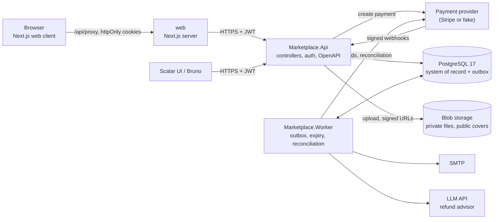

# Marketplace

[](https://github.com/berdeyyousra-ux/marketplace/actions/workflows/ci.yml)
[](https://github.com/berdeyyousra-ux/marketplace/actions/workflows/codeql.yml)
[](LICENSE)

A marketplace for downloadable digital products: ebooks, templates, fonts, audio.

- **Sellers** list products and upload the files.
- **Buyers** pay through a payment provider and download through short-lived signed links.
- **The platform** takes a commission, recorded in an append-only seller ledger.
- **Refunds** are reviewed by an admin, with an AI suggestion that is only ever advisory.

Built to production engineering standards:
- outbox-based reliability and idempotent writes
- webhook verification and payment reconciliation
- advanced SQL reporting
- an evaluated LLM feature
- security scanning in CI

> **Live demo:** not running right now. The Azure infrastructure (Bicep, OIDC sign-in) and the staging deployment
> pipeline are built and have deployed green; the staging resource group was then deleted to stop the charges.
> The [spec changelog](docs/spec-changelog.md) records what survived the teardown and how to bring it back. The URL
> will go here once staging is up again.

## What it does

- **Accounts:** registration with email confirmation, JWT access tokens with rotating refresh tokens and reuse detection, password reset, and account lockout.
- **Catalogue:** full-text search, filters and keyset pagination. Cover images are stripped of metadata and served from a public container.
- **Selling:** listing drafts with optimistic concurrency (ETags), file upload streamed to blob storage with magic-byte checks, and a publish flow.
- **Buying:**
  - idempotent order creation
  - payment through a provider (Stripe, or a fake provider for development) confirmed by signed webhooks
  - receipts by email
  - downloads through five-minute signed URLs, re-downloadable until the grant expires or a refund revokes it
- **Refunds:** the buyer requests one, a policy verdict is computed, and an LLM suggests an action. An admin approves or rejects it, and the Worker executes the refund against the provider.
- **Reporting:** a seller dashboard and admin reports from hand-written SQL (monthly revenue, cohorts, refund rates, percentiles), backed by covering indexes and a materialized view.
- **Web client:** a Next.js app for every role. It keeps tokens in httpOnly cookies and never exposes them to browser code.

## Architecture

A modular monolith in two processes that share one PostgreSQL database ([ADR 0001](docs/adr/0001-modular-monolith.md)).



- **The Api** handles HTTP, authentication, validation and transactions. Every side effect is written as an outbox row in the same transaction. Creating a payment is its only synchronous provider call, because the browser needs the client secret immediately.
- **The Worker** drains the outbox: email, refund execution and AI analysis. It also expires unpaid orders, reconciles payments with the provider, and cleans up. Retries go through Polly pipelines with backoff and dead-lettering.
- **Layers** follow a strict dependency rule, enforced by architecture tests:
  - `Domain` has no dependencies
  - `Application` (handlers, validators, ports) depends on Domain
  - `Infrastructure` (EF Core, Identity, Stripe, Blob, SMTP, LLM clients) depends on both
  - `Api`, `Worker` and `Tools` are the composition roots

## Run it locally

You need the .NET 10 SDK, Docker, and Node.js 22 for the web client.

```sh
# 1. PostgreSQL, Azurite (blob storage) and Mailpit (email)
docker compose up -d

# 2. Create the schema
dotnet tool restore
dotnet ef database update --project src/Marketplace.Infrastructure --startup-project src/Marketplace.Infrastructure \
  --connection "Host=localhost;Port=5432;Database=marketplace;Username=marketplace;Password=devpassword"

# 3. Demo data: 6 sellers, 60 products with files, 30 buyers, 400 orders
ConnectionStrings__Database="Host=localhost;Port=5432;Database=marketplace;Username=marketplace;Password=devpassword" \
ConnectionStrings__BlobStorage="UseDevelopmentStorage=true" \
dotnet run --project src/Marketplace.Tools -- seed-demo

# 4. The Api (http://localhost:8080) and the Worker, each in its own terminal
dotnet run --project src/Marketplace.Api
dotnet run --project src/Marketplace.Worker

# 5. The web client (http://localhost:3000)
cd web && cp .env.example .env.local && npm install && npm run dev
```

Then:

- **Accounts:** sign in as `buyer1@seed.test`, `seller1@seed.test` or `admin@seed.test`. The password is `seed password 2026` for all of them.
- **API reference:** http://localhost:8080/docs (Scalar).
- **Email:** confirmations and receipts arrive in Mailpit at http://localhost:8025.
- **Payments:** at checkout the fake provider completes a test payment; no card is involved.
- **AI suggestions:** these come from a deterministic fake client unless `Ai:Provider` is set to `Anthropic` or `OpenAi` with a key ([spec changelog](docs/spec-changelog.md)).
- **Containers:** `docker compose --profile app up -d` runs the Api and the Worker as containers instead, built from the production Dockerfiles.

### Configuration

Settings come from `appsettings.json`, environment variables (`Section__Key`) and, in Azure, Key Vault. Every section
below is checked while the process starts: a missing or unsafe value is logged at Fatal and the process exits, instead
of failing later on the first request that needs it.

| Section | Checked at startup |
| --- | --- |
| `ConnectionStrings` | `Database` and `BlobStorage` are both present |
| `Jwt` | signing keys are base64 and at least 32 bytes, and never the published development key outside Development |
| `Cors` | outside Development, at least one allowed origin and never `*` |
| `Payments` | provider is `Fake` or `Stripe`; `Stripe` in Production; Stripe's secret and webhook keys whenever it is the provider |
| `Storage` | both container names set, the public cover container differs from the private file container, positive signed-link lifetime |
| `Email` | SMTP host, port and sender set; a password whenever a user is set; `LinkBaseUrl` is an absolute http(s) URL |
| `Ai` | provider is `Fake`, `Anthropic` or `OpenAi`; model and key for a real provider; positive token and quota limits |
| `Marketplace` | commission between 0 and 10000 basis points |
| `Refunds` | a positive refund window |

## Test it

The integration tests start PostgreSQL and Azurite in containers (Testcontainers), so Docker must be running.

```sh
dotnet test --project tests/Marketplace.ArchitectureTests/Marketplace.ArchitectureTests.csproj  # layer rules, no repositories, no domain types in the API
dotnet test --project tests/Marketplace.UnitTests/Marketplace.UnitTests.csproj                  # domain rules, state machines, validators
dotnet test --project tests/Marketplace.IntegrationTests/Marketplace.IntegrationTests.csproj    # API end to end against real PostgreSQL
dotnet test --project tests/Marketplace.AiEvals/Marketplace.AiEvals.csproj                      # eval case set and replay gate
dotnet run --project src/Marketplace.Tools -- eval-refunds --mode recorded                       # AI eval over the recorded outputs
cd web && npm run build && npm run check:tokens                                                  # web type-check, build, design-token check
```

The integration suite also includes several snapshot and contract tests:
- **OpenAPI:** a snapshot of the API document, so contract changes are reviewed.
- **Schema contract:** checks the database against the spec's SQL.
- **Authorization matrix:** every endpoint against every role.
- **Failure modes:** the failure modes from spec section 10.

The [Bruno collection](bruno/README.md) runs every endpoint end to end against the local stack:

```sh
cd bruno && npx @usebruno/cli@4.2.1 run --env Local -r
```

CI runs all of the above except the Bruno collection, together with these checks:
- formatting
- migration bundle idempotency
- Docker builds scanned by Trivy
- vulnerable-package checks
- gitleaks secret scanning
- CodeQL

## Skill map

What this repository sets out to demonstrate, and where to read the evidence.

| Skill | Where it shows up |
| --- | --- |
| Domain modelling and explicit state machines | `src/Marketplace.Domain` (orders, payments, refunds, ledger) |
| Transactional outbox, retries and dead-lettering | `src/Marketplace.Infrastructure/Outbox`, `src/Marketplace.Worker` |
| Idempotent writes | `src/Marketplace.Api/Infrastructure/IdempotentAttribute.cs` |
| Payment webhooks, signature checks and reconciliation | `src/Marketplace.Application/Payments`, `src/Marketplace.Infrastructure/Payments` |
| Auth: rotating refresh tokens with reuse detection | `src/Marketplace.Application/Identity`, `src/Marketplace.Infrastructure/Identity` |
| Fail-fast configuration validation | `src/Marketplace.Infrastructure/DependencyInjection.cs`, `tests/Marketplace.IntegrationTests/Auth/StartupValidationTests.cs` |
| Advanced SQL and query tuning | [`docs/sql`](docs/sql) (queries and their plans), [ADR 0003](docs/adr/0003-reporting-indexes.md) |
| LLM feature with structured output, injection handling and evals | `src/Marketplace.Application/Refunds`, [`docs/ai-eval-report.md`](docs/ai-eval-report.md) |
| File handling: magic bytes, metadata stripping, signed URLs | `src/Marketplace.Application/Catalog/ProductFiles.cs`, `CoverImages.cs`, `src/Marketplace.Infrastructure/Storage` |
| Testing strategy | `tests/` (architecture, unit, integration with Testcontainers, AI evals) |
| CI and supply-chain security | [`.github/workflows`](.github/workflows), [`.github/dependabot.yml`](.github/dependabot.yml) |
| Infrastructure as code and deployment | [`deploy/bicep`](deploy/bicep), [`deploy/docker`](deploy/docker), [`cd-staging.yml`](.github/workflows/cd-staging.yml) |
| Web client: backend-for-frontend auth, single-flight token refresh | `web/lib/refresh.ts`, `web/proxy.ts`, [`web/README.md`](web/README.md) |
| Design system, theming and contrast budgets | `web/app/globals.css`, `web/components/ui`, [`docs/frontend-design-plan.md`](docs/frontend-design-plan.md) |
| Data visualization | `web/components/RevenueChart.tsx` |

## Documentation

- **Architecture decisions:**
  - [0001 Modular monolith](docs/adr/0001-modular-monolith.md)
  - [0002 Technology stack and banned libraries](docs/adr/0002-stack-and-banned-libraries.md)
  - [0003 Covering indexes for the report queries](docs/adr/0003-reporting-indexes.md)
- [Changelog](CHANGELOG.md): what shipped in each release.
- [Spec changelog](docs/spec-changelog.md): every deviation from the build specification, with its reason.
- [AI eval report](docs/ai-eval-report.md): accuracy, schema validity and injection recall of the refund advisor.
- [Seeding](docs/seeding.md): demo data and the one-million-order load data set.
- [Frontend design plan](docs/frontend-design-plan.md).

## Limitations

- **No live deployment right now.** The Bicep infrastructure and the staging pipeline work and have deployed green, but
  the staging resource group was deleted to stop the charges, so there is nothing to visit. The production pipeline
  (T-063) is deferred.
- **Stripe test payments:** the API and Worker support Stripe, but the web client has no Stripe payment form yet (T-064). Locally, checkout uses the fake provider.
- **Scope:**
  - payments in euros only, and no VAT calculation
  - refunds cover a whole order item; partial refunds are out of scope
  - seller payouts are recorded in the ledger but not paid out
- **The AI only advises.** It suggests an action with reasons and flags; an admin always decides. With the fake client, every suggestion is "needs more information".
- **Sessions have no reuse grace.** Sending a used refresh token revokes the whole session, by design. The web client serializes refreshes so this never happens in normal use. A refresh interrupted by typing a new address during its roughly 50 ms round trip can still sign the user out.
- **Observability is basic:** structured logs and health checks only. Metrics, tracing and alerts are planned for later (Kubernetes and OpenTelemetry).

## License

[MIT](LICENSE)
